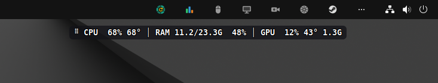

<div align="center">

# Floating Monitor

**CPU, RAM and GPU on a transparent line above everything, with an icon on the GNOME top bar.**


[](https://github.com/gabrielogregorio/devkit-floating-monitor/actions/workflows/tests.yml)
[](https://github.com/gabrielogregorio/devkit-floating-monitor/actions/workflows/check-quality.yml)
[](https://github.com/gabrielogregorio/devkit-floating-monitor/actions/workflows/codeql-analysis.yml)

<br>



</div>

## About

A floating line with CPU, RAM and GPU, read every 2 s:

```
⠿ CPU  29% 56° │ RAM 8.9/23.3G  38% │ GPU  27% 45° 0.8G
```

- 📊 **CPU** usage and temperature, **RAM** used/total and %, **GPU** usage, temperature and VRAM.
- 🔴 A block turns **red** over its limit: usage ≥ 80% (CPU, RAM, GPU or VRAM), CPU ≥ 85 °C,
  GPU ≥ 83 °C.
- 🪟 Stays **above every window** on every workspace, transparent with white text, drag it by the
  `⠿`; the position is saved.
- 📌 **Top bar icon**: colored when on, gray when off. No "Quit": it always stays there and comes up
  off at login.
- 🪶 **Light:** Python + GTK 3 from Ubuntu itself, no extra package, no subprocess per tick (reads
  `/proc`, `/sys` and NVML directly). About 71 MB of RAM, CPU near zero.
- 🌐 **Language:** the menu follows the system language (`pt*` shows Brazilian Portuguese, anything
  else English; `FM_LANG=en` or `FM_LANG=pt-BR` forces one).

Built and tested on Ubuntu 24.04 + GNOME (X11).

## Set up on a new PC

Uses the system Python: no pip and no venv to run it.

1. **X11 session** (Xorg). On Ubuntu 24.04: login screen → gear in the corner → "Ubuntu on Xorg".
   On Wayland the compositor does not let the window stay on top.
2. **Packages:**
   ```bash
   sudo apt install python3 python3-gi gir1.2-gtk-3.0 gir1.2-ayatanaappindicator3-0.1 \
                    gnome-shell-extension-appindicator
   ```
   The AppIndicator extension is already on in Ubuntu. On another GNOME, turn it on in *Extensions*
   (without it the icon does not show on the top bar). Without `gir1.2-ayatanaappindicator3-0.1`
   the app falls back to the legacy tray icon.
3. **Clone and install:**
   ```bash
   git clone <repo-url> devkit-floating-monitor
   cd devkit-floating-monitor
   ./install.sh        # app menu shortcut + start at login (comes up off: only the icon)
   ./verify.sh         # must end in OK
   ```
4. **Turn it on:** bars icon on the top bar → **On**. Or open "Floating Monitor" from the app menu.

**GPU:** NVIDIA is read through the proprietary driver (`libnvidia-ml.so.1`, shipped with
`nvidia-driver-*`). Without NVIDIA, AMD/Intel is read from `/sys` (`gpu_busy_percent`, untested);
without any GPU the block is hidden.

**Outside the repository** (the app makes them on its own):

| Path | What |
|---|---|
| `~/.config/devkit-floating-monitor/config.json` | position, modes and alert limits |
| `~/.cache/devkit-floating-monitor/icons/` | the on/off top bar icons (SVG) |
| `~/.local/share/applications/devkit-floating-monitor.desktop` | app menu shortcut (stores the folder path) |
| `~/.config/autostart/devkit-floating-monitor.desktop` | start at login with `--off` |

Moved the folder? Run `./install.sh` again: the shortcuts store the path. A config from the
versions before the rename (`~/.config/monitor-flutuante/config.json`) is carried over the first
time, with position and limits.

## Available scripts

```bash
# Run
./floating_monitor.py         # opens on (a 2nd run only shows the line)
./floating_monitor.py --off   # only the icon, like at login

# Install / remove the shortcuts and the start at login
./install.sh
./install.sh --no-autostart
./install.sh --remove

# Test
./verify.sh                   # no window: reads the sensors once and prints the line
./run-tests.sh                # ruff + shellcheck + pytest + verify.sh

# Dev tools (uv)
uv lock && uv export --frozen --all-groups --no-emit-project --no-hashes -o requirements-dev.txt
```

## Tests

| Kind | Where | What it covers |
|---|---|---|
| **Lint** | `pyproject.toml` (ruff), ShellCheck | Python style, import order, bug patterns; warnings in every `.sh` |
| **Unit** | `tests/test_*.py` (pytest) | CPU usage from `/proc/stat` deltas, the hwmon sensor pick (`Tctl`/`Tdie`/`Package id 0`/`temp1`), RAM from `/proc/meminfo`, the sysfs GPU and no GPU, the line and every red rule, config merge, the pre-rename migration and atomic save, icons, i18n catalog, `install.sh` in a fake `HOME` |
| **Smoke** | `verify.sh` | the real sensors of the machine once, without a window |

No test opens a window: the sensors read fake `/proc` and `/sys` trees in `tmp_path`. The GTK part
(window, drag, menu, top bar) is checked by hand on a real session.

## CI/CD

GitHub Actions, in `.github/`:

| Workflow | When | What |
|---|---|---|
| `tests.yml` | push/PR to `main`, manual | lint, unit and the smoke run on Ubuntu 24.04 with PyGObject from apt |
| `check-quality.yml` | push/PR to `main` | ruff, ShellCheck, `.sh` files executable in git, actions pinned to a hash, workflow YAML |
| `codeql-analysis.yml` | push/PR, weekly | CodeQL for Python and the workflows |
| `auto-complete-fields.yml` | PR opened/updated | assigns the author, labels by commit words and touched files, lists the commits in the PR body (`[...autoGenerate]`), titles it `Release vX.Y.Z - …`, fails if that version was already released |
| `create-tag-and-release.yml` | PR merged into `main` | creates the tag `vX.Y.Z` from `VERSION` and a GitHub release with the PR text, generated notes, the source tarball and `SHA256SUMS` (a `-rc.1` style version becomes a pre-release) |

`setup-environment` (composite action) installs `python3-gi` and `gir1.2-gtk-3.0` from apt and
creates the venv (`--system-site-packages`, for `gi`) from `requirements-dev.txt`.

**Pinned versions.** Every third-party action is pinned to the full commit hash of its release tag,
with the version as a comment, so a moved or hijacked tag cannot change what runs:

| Action | Version | Commit |
|---|---|---|
| `actions/checkout` | v6.1.0 | `d23441a48e516b6c34aea4fa41551a30e30af803` |
| `actions/github-script` | v8.0.0 | `ed597411d8f924073f98dfc5c65a23a2325f34cd` |
| `github/codeql-action` (init, analyze) | v4.39.1 | `9b3254085494b55a0f7c4c2b3d2d52cc712ce370` |

The rest is pinned too: runners on `ubuntu-24.04` (not `ubuntu-latest`) and the dev tools from
`uv.lock` (through `requirements-dev.txt`, ruff included). `check-quality.yml` fails if a `uses:`
is not a 40-character hash (local `./` actions excepted). Dependabot opens a monthly PR that bumps
the hash and the comment together. To pin one by hand:

```bash
git ls-remote --tags https://github.com/actions/checkout.git 'v6.1.0^{}' 'v6.1.0'   # the ^{} line, when present, is the commit
```

### Releasing

1. In the PR, bump `VERSION` (semver: `1.1.0`, or `1.1.0-rc.1` for a pre-release).
2. Merge into `main`. The tag and the release are created on their own.

What the release is built from:

| Part | Source |
|---|---|
| Tag | `v` + `VERSION` at the merge commit, pointing at that commit |
| Title | `Floating Monitor vX.Y.Z` |
| Notes | the PR title (without the `Release vX.Y.Z - ` prefix), then the PR body with the commit list that `auto-complete-fields.yml` filled in (the `[...autoGenerate]` marker is removed), then GitHub's generated notes (merged PRs, contributors, "Full Changelog" link to the previous tag) |
| Files | `devkit-floating-monitor-X.Y.Z.tar.gz` (`git archive` of the merge commit: only tracked files) and `SHA256SUMS` |
| Type | a version with `-` (e.g. `1.1.0-rc.1`) is a pre-release; any other becomes "latest" |

If the tag already exists (the PR did not bump `VERSION`), nothing is released and the run leaves a
warning. The PR check `VERSION is new` catches that before the merge.

Issues use forms (`bug_report.yml`, `feature_request.yml`); PRs start from `pull_request_template.md`.

## Usage

| Action | How |
|---|---|
| Move | hold the `⠿` and drag (the position is saved) |
| Menu | click anywhere on the text |
| Turn on/off | top bar icon menu → "On" |
| Menu from the bar | right click on the icon (legacy tray) or click (AppIndicator) |

Menu: a first line with the name, what it is and the state ("Floating Monitor (CPU, RAM and GPU):
on"), then On, always on top, transparent (white text), lock position, pause reading, back to the
screen corner, open System Monitor. "On" turns the line on and off (off = hidden and not reading).

## Architecture

```
/proc/stat, /proc/meminfo ─┐
/sys/class/hwmon (temp)  ──┼─> build_line() ──> Gtk.Label markup (redrawn only when it changes)
NVML (ctypes) or sysfs GPU ┘        every 2 s (GLib timer, stopped while off or paused)

Gtk.Application (single instance) ── window: undecorated, RGBA, UTILITY, sticky, keep-above
                                  └─ top bar: AyatanaAppIndicator3, or Gtk.StatusIcon as fallback
```

## Project layout

```
floating_monitor.py   the app: config, sensors (Cpu, read_ram, Gpu), build_line, Monitor (GTK 3)
i18n.py               menu and title strings (en / pt-BR)
install.sh            app menu shortcut + autostart (--no-autostart, --remove)
verify.sh             reads the sensors once without a window
run-tests.sh          lint + pytest + verify.sh, same as the CI
tests/                pytest with fake /proc and /sys trees
.github/              workflows, composite action, issue forms, PR template
docs/                 README screenshot
```

Adding text: write it in English inside `tr("…")` and add the pt-BR line to `PT_BR` in `i18n.py`.
`tests/test_i18n.py` fails if a line is missing, if the `{placeholders}` differ or if a pt-BR line
is no longer used.

## Dependencies

Running needs only the apt packages above. `pyproject.toml` lists the dev tools (pytest,
pytest-cov, ruff), `uv.lock` locks them and `requirements-dev.txt` is the export of the lock:

```bash
python3 -m venv --system-site-packages .venv      # --system-site-packages: gi comes from apt
.venv/bin/pip install -r requirements-dev.txt     # never a global pip (PEP 668)
```

After changing `pyproject.toml`: `uv lock` and export `requirements-dev.txt` again (command in
[Available scripts](#available-scripts)).

## Settings

`~/.config/devkit-floating-monitor/config.json` (the menu writes it; the limits only here):

```json
{ "usage_limit": 80, "cpu_temp_limit": 85, "gpu_temp_limit": 83 }
```

Edited it? Turn the line off and on again from the menu, or restart the app.

| Variable | Default | What |
|---|---|---|
| `FM_LANG` | unset | `en` or `pt-BR` for the menu (default: system language) |

## Troubleshooting

- Not on top: check `echo $XDG_SESSION_TYPE`. On `wayland` GNOME does not allow it; pick "Ubuntu
  on Xorg" at login.
- Gone: click the top bar icon or run `./floating_monitor.py`.
- Off screen: icon menu → "Back to the screen corner".

## Limitations

- **X11 only** for "always on top" (Wayland vetoes it; `GDK_BACKEND=x11` through XWayland is
  untested).
- One GPU: the first NVIDIA one (index 0), or the first DRM card with `gpu_busy_percent`.
- The alert limits are edited in the JSON, not from the menu.
- The line takes mouse clicks (no click-through).

## License

[MIT](LICENSE). Use, copy, modify and distribute freely; the software is provided "as is", without
warranty of any kind.
